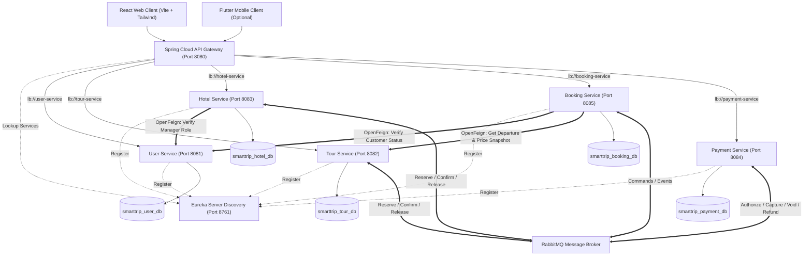
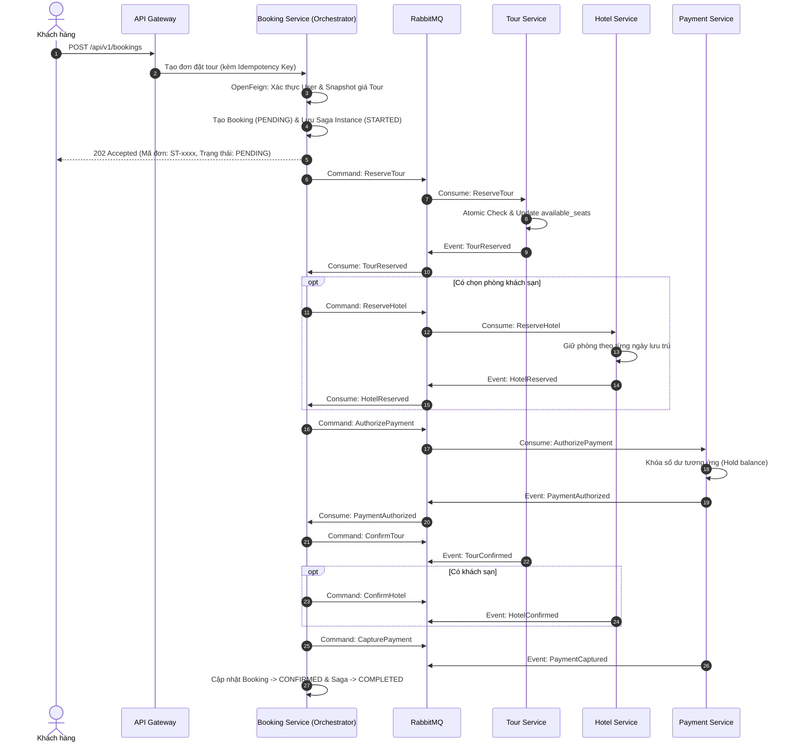

# SMARTTRIP — Smart Travel Booking Platform
> **Môn học:** MSS301 — Microservices with Spring Boot (FA26)  
> **Cơ sở:** Đại học FPT Đà Nẵng  
> **Kiến trúc:** Microservices (Spring Boot, Spring Cloud Netflix Eureka, Spring Cloud Gateway, OpenFeign, RabbitMQ, Saga Orchestration, Database per Service, MySQL, React + Vite)

---

## 1. Giới thiệu ý tưởng đề tài (Project Idea)

### 1.1. Bối cảnh & Bài toán nghiệp vụ
Trong các hệ thống du lịch trực tuyến (OTA - Online Travel Agency), quy trình đặt tour trọn gói thường đòi hỏi sự phối hợp chặt chẽ giữa nhiều miền nghiệp vụ độc lập:
1. **Thông tin Tour & Lịch khởi hành:** Kiểm tra số lượng chỗ còn khả dụng của tour.
2. **Khách sạn (Tùy chọn):** Đặt phòng lưu trú tương ứng với ngày khởi hành của tour.
3. **Thanh toán (Mock Wallet):** Quản lý số dư, giữ tiền tạm thời (Authorize) và trừ tiền thực tế (Capture).
4. **Đơn đặt tour (Booking):** Lưu trữ snapshot dữ liệu bất biến và quản lý trạng thái đơn hàng.

Nếu triển khai theo kiến trúc **Monolith**, toàn bộ quy trình trên có thể gói gọn trong một Database Transaction duy nhất (ACID). Tuy nhiên, khi hệ thống phát triển quy mô lớn và được chia thành các **Microservices độc lập** với **Database riêng biệt (Database per Service)**, việc giữ tính nhất quán dữ liệu trở thành một thách thức phân tán kinh điển:
- Không thể sử dụng giao dịch ACID truyền thống giữa các cơ sở dữ liệu khác nhau.
- Nếu một khâu thất bại (ví dụ: phòng khách sạn hết, hoặc số dư ví không đủ), hệ thống phải **tự động hoàn tác/bù trừ (Compensation)**: giải phóng số chỗ tour đã giữ, hủy đặt phòng và hoàn tiền.
- Hiện tượng tranh chấp tài nguyên (Concurrency / Race Condition) khi hàng chục người cùng đặt chỗ cuối cùng của một chuyến đi.

### 1.2. Giải pháp của SmartTrip
**SmartTrip** là nền tảng đặt tour du lịch thông minh được xây dựng hoàn chỉnh theo kiến trúc **Microservices chuẩn doanh nghiệp**, giải quyết trọn vẹn các thách thức phân tán:
- **Phân tách ranh giới rõ ràng (Bounded Contexts):** Mỗi service sở hữu database riêng, không join chéo, không dùng chung JPA Entity.
- **Service Discovery & API Gateway:** Sử dụng **Spring Cloud Netflix Eureka** để đăng ký dịch vụ động và **Spring Cloud Gateway** làm điểm truy cập duy nhất (Single Entry Point), định tuyến cân bằng tải qua `lb://`.
- **Giao tiếp đồng bộ (Synchronous):** Sử dụng **Spring Cloud OpenFeign** kết hợp Eureka cho các tác vụ tra cứu, xác thực tài khoản và snapshot giá tức thời trước khi tạo đơn.
- **Giao dịch phân tán (Distributed Transaction):** Triển khai mẫu hình **Saga Orchestration** trên nền **RabbitMQ**, điều phối luồng đặt tour và hủy tour với cơ chế bù trừ giao dịch (Compensating Transactions).
- **Độ tin cậy cao (Reliability Patterns):** Áp dụng **Transactional Outbox** chống mất mát sự kiện (dual-write), **Idempotent Consumer** chống xử lý trùng lặp message, **Dead Letter Queue (DLQ)** cho message lỗi, và **Concurrency Control (Atomic Updates)** chống bán vượt số chỗ (overbooking).

---

## 2. Các vai trò người dùng (User Roles)

Hệ thống hỗ trợ 5 nhóm tác nhân với ma trận phân quyền chặt chẽ:

| Vai trò | Mô tả & Trách nhiệm chính |
|---|---|
| **Guest** | Người dùng vãng lai chưa đăng nhập: Tìm kiếm tour, lọc theo điểm đến/giá, xem lịch khởi hành, xem danh sách phòng khách sạn. |
| **Customer** | Khách hàng đã đăng ký: Quản lý hồ sơ cá nhân, nạp tiền ví giả lập (Mock Wallet), tạo booking đặt tour + phòng khách sạn, theo dõi trạng thái đơn hàng thời gian thực, hủy booking và nhận tiền hoàn theo chính sách. |
| **Tour Operator** | Đối tác vận hành tour: Quản lý danh mục tour, quản lý lịch khởi hành (Departure), thiết lập sức chứa (Capacity), theo dõi danh sách hành khách đặt tour. |
| **Hotel Manager** | Quản lý khách sạn: Quản lý thông tin khách sạn, cấu hình loại phòng (Room Types), cập nhật số lượng phòng trống theo ngày (Daily Inventory). |
| **Admin** | Quản trị viên hệ thống: Quản lý tài khoản và phân quyền người dùng, giám sát các giao dịch Saga (Saga Monitoring Dashboard), tra cứu lỗi và lịch sử bù trừ giao dịch (Compensation Audit). |

---

## 3. Kiến trúc Microservices & Phân rã dịch vụ

### 3.1. Sơ đồ kiến trúc tổng thể (System Architecture)



### 3.2. Danh sách các Service trong hệ thống

| Tên Service | Port | Database | Trách nhiệm chính |
|---|---|---|---|
| **Discovery Service** | `8761` | — | Trung tâm **Eureka Server**, quản lý Service Registry & Heartbeat cho toàn hệ thống. |
| **API Gateway** | `8080` | — | **Spring Cloud Gateway**, điểm tiếp nhận request duy nhất, xác thực token JWT, rate limiting, routing động qua Eureka (`lb://`). |
| **User Service** | `8081` | `smarttrip_user_db` | Identity Service: Quản lý xác thực (Register/Login), phát sinh và kiểm tra JWT, quản lý phân quyền (RBAC) và hồ sơ người dùng. |
| **Tour Service** | `8082` | `smarttrip_tour_db` | Quản lý thông tin Tour, Điểm đến, Lịch khởi hành (Departures), quản lý số chỗ và thực hiện giữ/xác nhận/giải phóng chỗ cho tour. |
| **Hotel Service** | `8083` | `smarttrip_hotel_db` | Quản lý Khách sạn, Loại phòng, Tồn kho phòng theo ngày (Daily Inventory), xử lý giữ/xác nhận/hủy phòng. |
| **Payment Service** | `8084` | `smarttrip_payment_db` | Quản lý Ví mô phỏng (Mock Wallet), sổ cái giao dịch (Ledger), thực hiện Authorize (giữ tiền), Capture (trừ tiền), Void (hủy giữ) và Refund (hoàn tiền). |
| **Booking Service** | `8085` | `smarttrip_booking_db` | Tiếp nhận đơn đặt tour, snapshot thông tin & giá, đóng vai trò **Saga Orchestrator** điều phối luồng giao dịch phân tán giữa các service. |

---

## 4. Cơ chế giao tiếp giữa các Microservices

### 4.1. Giao tiếp đồng bộ qua Spring Cloud OpenFeign
Đáp ứng yêu cầu bắt buộc của môn học ($\ge 2$ kịch bản gọi OpenFeign), SmartTrip sử dụng Feign Client kết hợp với Eureka Service Discovery:

1. **Kịch bản 1 (`Booking Service` $\rightarrow$ `User Service`):**  
   - *Mục đích:* Trước khi tiếp nhận đơn hàng, `Booking Service` gọi sang `User Service` (`GET /internal/v1/users/{id}/status`) để kiểm tra tài khoản khách hàng. Nếu tài khoản bị khóa (`BLOCKED`) hoặc không tồn tại, hệ thống từ chối ngay lập tức với lỗi `403 Forbidden`, không cần khởi động Saga.
2. **Kịch bản 2 (`Booking Service` $\rightarrow$ `Tour Service`):**  
   - *Mục đích:* Khi khách hàng gửi yêu cầu đặt chỗ, `Booking Service` gọi sang `Tour Service` (`GET /internal/v1/departures/{id}`) để lấy thông tin chi tiết về lịch trình và đơn giá hiện tại. Hệ thống thực hiện snapshot giá độc lập vào database của Booking Service nhằm bảo đảm tính bất biến của hợp đồng đặt tour.
3. **Kịch bản 3 (`Hotel Service` $\rightarrow$ `User Service`):**  
   - *Mục đích:* Xác thực vai trò `HOTEL_MANAGER` và quyền hạn sở hữu khách sạn khi thực hiện các tác vụ tạo mới hoặc cập nhật phòng.

### 4.2. Giao tiếp bất đồng bộ qua RabbitMQ & Saga Orchestration
Quy trình đặt tour phức tạp được điều phối bởi **Booking Service (Orchestrator)** qua các Command và Event:



*Trong trường hợp bất kỳ bước nào thất bại (ví dụ: Tour hết chỗ, Khách sạn hết phòng, hoặc Ví không đủ tiền), Orchestrator sẽ kích hoạt chuỗi **Compensating Transactions** (Release Tour, Release Hotel, Void Authorization) để đưa toàn bộ hệ thống về trạng thái nhất quán.*

---

## 5. Công nghệ sử dụng (Tech Stack)

- **Ngôn ngữ:** Java 21 (LTS)
- **Framework nền tảng:** Spring Boot 3.x / 4.x
- **Hạ tầng Microservices:**
  - **Service Discovery:** Spring Cloud Netflix Eureka Server
  - **API Gateway:** Spring Cloud Gateway (Reactive, WebFlux-based)
  - **Giao tiếp đồng bộ:** Spring Cloud OpenFeign
  - **Cân bằng tải:** Spring Cloud LoadBalancer
- **Bảo mật:** Spring Security, JWT (JSON Web Token), BCrypt Password Hashing
- **Cơ sở dữ liệu:** MySQL 8.x (Database-per-Service: 5 cơ sở dữ liệu riêng biệt)
- **ORM & Di chuyển dữ liệu:** Spring Data JPA / Hibernate, Flyway Migration
- **Message Broker:** RabbitMQ (Topic Exchange, Dead Letter Exchange)
- **Front-end:** React, Vite, TypeScript, Tailwind CSS, TanStack Query
- **Kiểm thử:** JUnit 5, Mockito, Testcontainers, Postman Collection
- **Đóng gói & Vận hành:** Docker & Docker Compose (Monorepo)

---

## 6. Cấu trúc thư mục Monorepo

```text
smarttrip/
├── backend/
│   ├── discovery-service/        # Eureka Server (Service Registry & Discovery)
│   ├── api-gateway/              # Spring Cloud Gateway (Routing & JWT Filter)
│   ├── user-service/             # Identity & Profile Service (smarttrip_user_db)
│   ├── tour-service/             # Tour & Departure Management (smarttrip_tour_db)
│   ├── hotel-service/            # Hotel & Daily Room Inventory (smarttrip_hotel_db)
│   ├── payment-service/          # Mock Wallet & Payment Ledger (smarttrip_payment_db)
│   └── booking-service/          # Booking & Saga Orchestrator (smarttrip_booking_db)
│
├── web/                          # Ứng dụng Web (React + Vite + Tailwind CSS)
│   ├── src/
│   │   ├── features/             # auth, tours, hotels, booking, wallet, admin
│   │   └── components/           # reusable UI & Saga visualizer
│   └── package.json
│
├── infrastructure/               # Cấu hình Docker, MySQL init scripts, RabbitMQ definitions
│   ├── mysql/
│   │   └── init/                 # Script khởi tạo 5 database độc lập
│   └── rabbitmq/
│
├── docs/                         # Tài liệu đặc tả, sơ đồ kiến trúc, tài liệu API
│   ├── SMARTTRIP_PROJECT_DOCUMENTATION.md
│   └── architecture_diagrams/
│
├── docker-compose.yml            # Docker Compose chạy toàn bộ hệ thống 
├── .env.example                  # File biến môi trường mẫu
└── README.md                     # Tài liệu tổng quan dự án
```

---

## 7. Quy trình làm việc nhóm trên GitHub (Teamwork Workflow)

Dự án tuân thủ nghiêm ngặt chuẩn quản lý mã nguồn và làm việc nhóm theo mô hình Git Flow (được quy định chi tiết trong [HuongDan.md](file:///d:/MSS301/repo/projectFinal/HuongDan.md)):

1. **Quản lý công việc qua GitHub Projects & Milestones:**
   - Thiết lập GitHub Project Board theo luồng: `Backlog` $\rightarrow$ `To do (Sprint)` $\rightarrow$ `In progress` $\rightarrow$ `In review` $\rightarrow$ `Done`.
   - Phân chia Milestone theo 4 Checkpoint của môn học (CP1: Tuần 1, CP2: Tuần 4, CP3: Tuần 7, CP4: Tuần 9).
2. **Quy tắc phân nhánh (Branching Convention):**
   - Không commit trực tiếp lên nhánh `main` hoặc `develop`.
   - Mọi tính năng/sửa lỗi đều tạo nhánh từ `develop`: `feature/<issue-number>-<feature-name>` hoặc `chore/<issue-number>-<task-name>`.
3. **Quy trình Issue & Pull Request:**
   - Mỗi tác vụ đều có Issue mô tả rõ tiêu chí chấp nhận (Acceptance Criteria).
   - Commit message chuẩn: `feat(tour): add capacity validation (Refs #12)`.
   - Mở Pull Request (PR) theo template, gắn từ khóa `Closes #12`.
   - **Review xoay vòng:** Bắt buộc có ít nhất 1 thành viên review và approve trước khi thực hiện **Squash and Merge** vào `develop`.

---

## 8. Hướng dẫn khởi chạy nhanh (Quick Start)

### Yêu cầu môi trường
- JDK 21 (LTS)
- Apache Maven 3.9+
- Node.js 20+ & npm / pnpm
- Docker & Docker Compose

### Khởi chạy toàn bộ hệ thống bằng Docker Compose

1. **Clone repository:**
   ```bash
   git clone https://github.com/<your-org>/smarttrip.git
   cd smarttrip
   ```

2. **Cấu hình môi trường:**
   ```bash
   cp .env.example .env
   # Chỉnh sửa mật khẩu hoặc thông số cổng nếu cần
   ```

3. **Khởi động các dịch vụ qua Docker Compose:**
   ```bash
   docker compose up -d --build
   ```

4. **Kiểm tra trạng thái các dịch vụ:**
   - **Eureka Dashboard:** [http://localhost:8761](http://localhost:8761) *(Kiểm tra đủ 5 business services và API Gateway đã đăng ký UP)*
   - **RabbitMQ Management:** [http://localhost:15672](http://localhost:15672) *(Tài khoản: `smarttrip` / `smarttrip123`)*
   - **API Gateway (Swagger tổng hợp):** [http://localhost:8080/swagger-ui.html](http://localhost:8080/swagger-ui.html)
   - **React Web Client:** [http://localhost:3000](http://localhost:3000)

---

## 9. Tài khoản kiểm thử mẫu (Demo Credentials)

| Vai trò | Email / Username | Mật khẩu | Chức năng kiểm thử |
|---|---|---|---|
| **Admin** | `admin@smarttrip.vn` | `Admin@123` | Quản lý người dùng, xem Saga Monitoring Dashboard, xem audit log |
| **Tour Operator** | `operator@smarttrip.vn` | `Operator@123` | Tạo tour mới, cấu hình lịch khởi hành, quản lý sức chứa |
| **Hotel Manager** | `hotelier@smarttrip.vn` | `Hotel@123` | Cấu hình khách sạn, loại phòng, số lượng phòng theo ngày |
| **Customer** | `customer@gmail.com` | `Customer@123` | Nạp ví mô phỏng, tìm tour, tạo booking, hủy booking |
